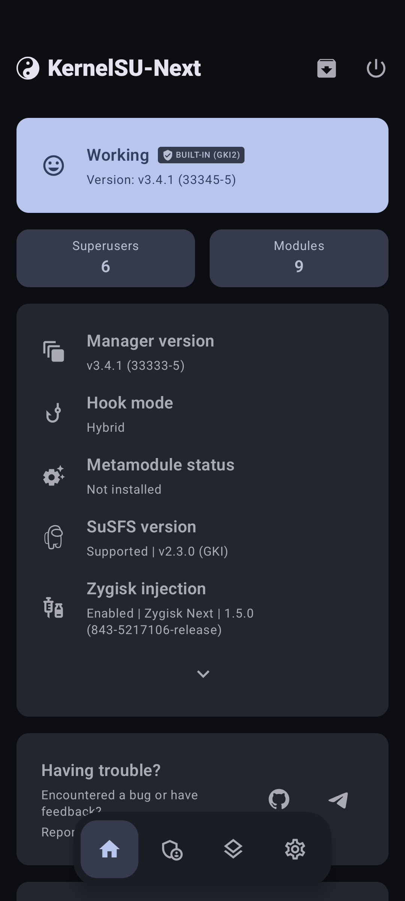
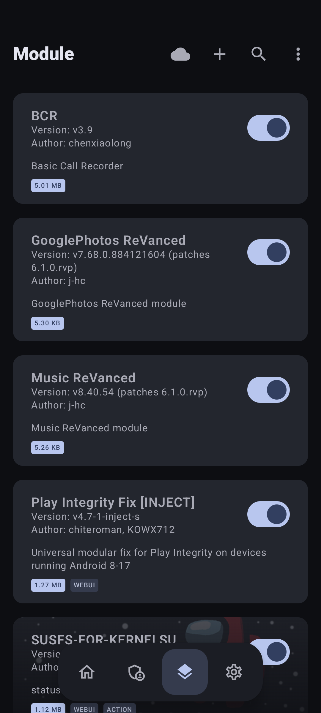

# 🚀 POCO F5 (`marble`) — Ядро LineageOS 23.2 (Android 16) з KernelSU-Next & SUSFS

[English](README.md) | **Українська**

[-3DDC84?logo=android&logoColor=white)](https://android.com)
[](https://lineageos.org)
[](https://en.wikipedia.org/wiki/Poco_F5)
[](https://kernel.org)
[-success)](https://github.com/KernelSU-Next/KernelSU-Next)
[-blueviolet)](https://gitlab.com/simonpunk/susfs4ksu)
[](LICENSE)
[](#-перевірка-та-скріншоти)

Офіційне джерело та набір інструментів для збірки й встановлення оптимізованого ядра **Linux GKI 5.10.269** для **Xiaomi POCO F5 / Redmi Note 12 Turbo (`marble` / `marblein`)** на базі **LineageOS 23.2 (Android 16)** з повною нативною підтримкою **KernelSU-Next v3.4.1** та модуля **SUSFS v2.3.0**.

> 💡 **Детальний технічний розбір усіх помилок, аналіз бутлупів, ABI та AVB доступний у файлі [roadmap.md](roadmap.md)**.

---

## 📸 Перевірка та скріншоти

Ядро успішно протестоване на реальному смартфоні **POCO F5 (marble)** під керуванням офіційного білду `lineage-23.2-20261006-NIGHTLY-marble`. Усі 9 модулів Magisk/Zygisk активні, режим зворотної сумісності `sucompat` активований, попередження про несумісність ядра відсутні.

<p align="center">
  
  &nbsp;&nbsp;&nbsp;&nbsp;
  
</p>

---

## ✨ Особливості збірки

* **Чиста сумісність з GKI 2.0 та Vendor DLKM**:
  Конфігурація повністю узгоджена з офіційними модулями ядра Qualcomm (`/vendor_dlkm`). Вимкнено небезпечні діагностичні прапорці (`CONFIG_PAGE_OWNER`, `CONFIG_DEBUG_FS`), що змінюють розмір `struct page`, забезпечуючи бездоганне монтування та шифрування `/data`.
* **KernelSU-Next v3.4.1 (33345-5)**:
  Інтеграція з форку [pershoot/KernelSU-Next](https://github.com/pershoot/KernelSU-Next) (гілка `dev-susfs`) із нативною підтримкою протоколу драйвера v3.4+, повноцінним `su` та підтримкою Android 16.
* **SUSFS v2.3.0 (Всі 9 фіч увімкнено)**:
  - `CONFIG_KSU_SUSFS_SUS_PATH` (Маскування шляхів)
  - `CONFIG_KSU_SUSFS_SUS_MOUNT` (Приховання точок монтування)
  - `CONFIG_KSU_SUSFS_SUS_KSTAT` (Підміна атрибутів kstat)
  - `CONFIG_KSU_SUSFS_SPOOF_UNAME` (Підміна uname)
  - `CONFIG_KSU_SUSFS_ENABLE_LOG` (Журналювання подій)
  - `CONFIG_KSU_SUSFS_HIDE_KSU_SUSFS_SYMBOLS` (Приховання символів ядра)
  - `CONFIG_KSU_SUSFS_SPOOF_CMDLINE_OR_BOOTCONFIG` (Підміна bootconfig / cmdline)
  - `CONFIG_KSU_SUSFS_OPEN_REDIRECT` (Перенаправлення системного виклику open)
  - `CONFIG_KSU_SUSFS_SUS_MAP` (Захист адресного простору)
* **Готовий AVB Hash Footer (Flags: 3)**:
  Образ `boot.img` містить валідний AVB Footer з точним солоним SHA256 дайджестом та прапором вимкнення верифікації, що виключає вильоти в Fastboot при старті завантажувача Qualcomm ABL.

---

## 📦 Релізні файли

Готові файли знаходяться у директорії [`output/`](output/):

| Файл | Опис | Розмір |
|---|---|---|
| **`AnyKernel3-marble-ksunext-susfs-LineageOS-23.2.zip`** | Прошиваний zip-архів для встановлення через OrangeFox / Recovery | ~22.8 MB |
| **`boot-ksunext-susfs-LineageOS-23.2-marble.img`** | Готовий образ boot для прошивки через `fastboot` | 192 MB (201,326,592 B) |

### Контрольні суми SHA-256
```text
5501e483e5cda27dcd02a5589ba7886517a58a974049eb0fe92a9932eca63287  boot-ksunext-susfs-LineageOS-23.2-marble.img
e08c0c26579a9f0995836fa79494304eb68c13c7bc67ffd6e0f5b883f30ae667  AnyKernel3-marble-ksunext-susfs-LineageOS-23.2.zip
```

---

## ⚡ Інструкція зі встановлення

### Спосіб 1: Через Custom Recovery (OrangeFox / TWRP) — **Рекомендовано**
1. Скопіюйте `AnyKernel3-marble-ksunext-susfs-LineageOS-23.2.zip` на пам'ять смартфона або OTG-флешку.
2. Перезавантажтеся в рекавері:
   ```bash
   adb reboot recovery
   ```
3. Оберіть zip-архів та підтвердіть прошивку (свайп праворуч).
4. Перезавантажте пристрій у систему (`Reboot System`).

---

### Спосіб 2: Через Fastboot
1. Переведіть пристрій у режим Fastboot:
   ```bash
   adb reboot bootloader
   ```
2. Дізнайтеся ваш поточний активний слот:
   ```bash
   fastboot getvar current-slot
   ```
3. Прошийте образ у відповідний слот:
   * Якщо активний слот **b**:
     ```bash
     fastboot flash boot_b output/boot-ksunext-susfs-LineageOS-23.2-marble.img
     ```
   * Якщо активний слот **a**:
     ```bash
     fastboot flash boot_a output/boot-ksunext-susfs-LineageOS-23.2-marble.img
     ```
4. Перезавантажте пристрій:
   ```bash
   fastboot reboot
   ```

---

## 🛠️ Збірка з вихідного коду (Build from Source)

### 1. Вимоги
* Linux x86_64 (Ubuntu 22.04+, Arch Linux, Debian тощо)
* Пакет `python3`, `git`, `make`, `bc`, `bison`, `flex`, `libssl-dev`
* Google AOSP Clang: `clang-r547379` (або новіший)
* Утиліта `avbtool` (`sudo pacman -S android-tools` або `pip install avbtool`)

### 2. Клонування та накладання патчів
```bash
./patch_kernel.sh
```
Скрипт автоматично завантажить ядро LineageOS, підтягне гілку `dev-susfs` KernelSU-Next, накладе патчі ядра SUSFS та виправить файли складання.

### 3. Компіляція
Вкажіть шлях до компілятора Clang та запустіть збірку:
```bash
export CLANG_DIR="$HOME/toolchains/aosp-clang/clang-r547379"
./build_kernel.sh
```
Ядро буде зібрано з чистим конфігом `configs/marble_lineageos_23.2_ksunext_susfs.config`. Готовий файл `Image` автоматично скопіюється в `AnyKernel3/Image`.

### 4. Пакування релізних файлів
```bash
./package_kernel.sh
```
Скрипт створить архів `AnyKernel3-*.zip` та перепакує стоковий boot з оновленням AVB хешів.

---

## 🔍 Перевірка працездатності

Підключіть телефон до ПК через USB з увімкненим налагодженням та виконайте:

```bash
adb shell
uname -a
# Вивід: Linux localhost 5.10.269-gki-g490755fcc6cc #3 SMP PREEMPT ... aarch64 Toybox

su -v
# Вивід: 3.4.1:KernelSU

ksu_susfs show version
# Вивід: v2.3.0

ksu_susfs show enabled_features
# Усі 9 фіч зі статусом 1
```

---

## 🤝 Подяки та контакти (Credits & Contacts)

### Credits
* **[LineageOS Team](https://github.com/LineageOS)** — за офіційне дерево ядра та підтримку POCO F5 (`sm8450`).
* **[pershoot](https://github.com/pershoot)** — за підтримку інтеграції KernelSU-Next та SUSFS у гілці `dev-susfs`.
* **[simonpunk](https://gitlab.com/simonpunk)** — за створення модуля ядра SuSFS4KSU.
* **[osm0sis](https://github.com/osm0sis)** — за інструмент пакування AnyKernel3.
* **[tiann](https://github.com/tiann)** & **[rifsxd](https://github.com/rifsxd)** — за розробку KernelSU та KernelSU-Next.

### Contacts & Maintainer
* **Maintainer**: onix
* **Email**: [onixtheoni@gmail.com](mailto:onixtheoni@gmail.com)
* **Bug Reports & Feedback**: GitHub Issues & Pull Requests

---

## 📄 Ліцензія (License)

Цей проєкт ліцензовано на умовах **GNU General Public License v2.0** (GPL-2.0). Повний текст ліцензії доступний у файлі [LICENSE](LICENSE).
